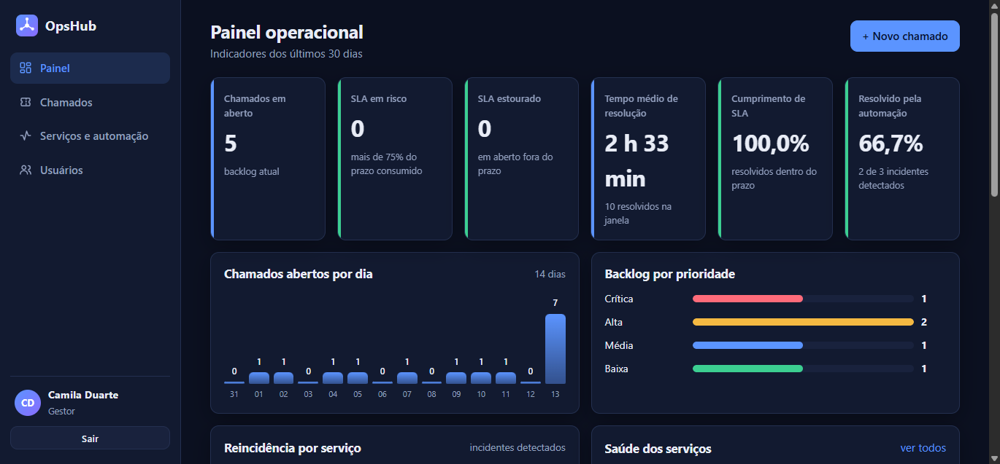
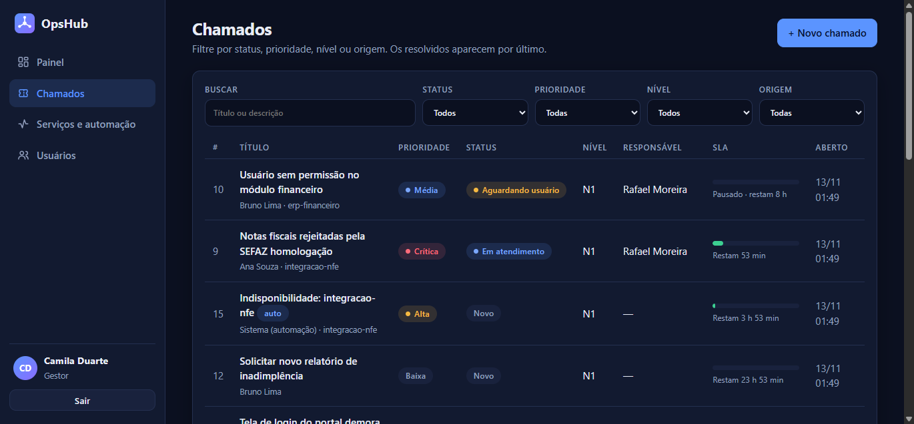
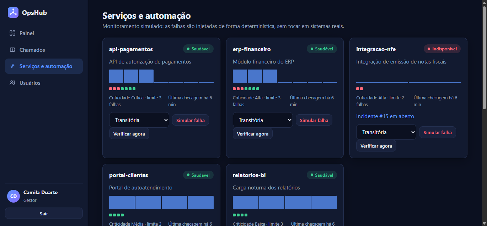
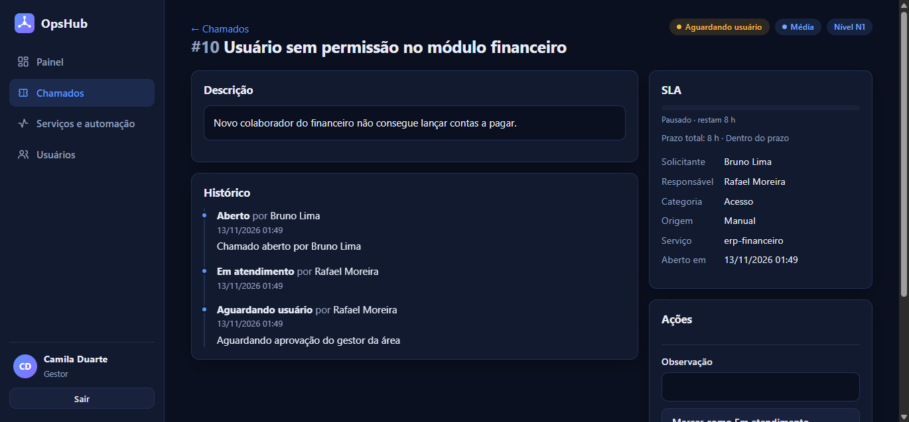

# OpsHub

Plataforma de **service desk com SLA, monitoramento simulado e automação de incidentes**, construída de ponta a ponta:
API REST segura (JWT), interface web renderizada no servidor, banco PostgreSQL versionado e suíte de testes automatizados.

> **Projeto de portfólio, com dados 100% fictícios.** Não está ligado a nenhum cliente, empregador ou sistema real.
> O monitoramento é **simulado** (falhas injetadas de forma determinística): nada aqui toca sistemas de terceiros.

## O que ele faz

- **Chamados com SLA**: prazo por prioridade (Crítica 1 h, Alta 4 h, Média 8 h, Baixa 24 h), pausa automática quando o chamado aguarda o usuário, alerta de risco ao consumir 75% do prazo e indicação de estouro.
- **Fluxo com regras de negócio**: máquina de estados (Novo → Em atendimento → Aguardando usuário → Resolvido), escalonamento N1 → N2 **com evidência obrigatória**, causa raiz na resolução e histórico completo de eventos.
- **Perfis e permissões** (Solicitante, Analista N1, Analista N2, Gestor): cada um vê e faz apenas o que lhe cabe, na API e na interface.
- **Monitoramento e automação**: serviços com verificação periódica; após *N* falhas consecutivas abre-se um incidente (no máximo um aberto por serviço); *runbooks* tentam recuperar sozinhos (reiniciar serviço, limpar cache); o que a automação não resolve fica aberto para uma pessoa. Ao resolver o chamado, o serviço volta a ficar saudável.
- **Indicadores**: backlog, SLA em risco/estourado, tempo médio de resolução, cumprimento de SLA, % resolvido pela automação, reincidência por serviço e chamados abertos por dia.
- **Observabilidade**: Actuator e métricas Prometheus (`/actuator/prometheus`).

## Capturas de tela

| Painel | Chamados |
|---|---|
|  |  |
| **Serviços e automação** | **Detalhe do chamado** |
|  |  |

As imagens foram geradas a partir de uma execução local com os dados de demonstração.

## Stack

Java 21 · Spring Boot 3.5 (Web MVC, Security, Data JPA, Validation, Actuator) · Thymeleaf + htmx · PostgreSQL · Flyway ·
JWT (Nimbus) · springdoc/Swagger · Micrometer/Prometheus · JUnit 5, Mockito, AssertJ, MockMvc, PostgreSQL embutido (zonky) · JaCoCo · Docker.

## Como rodar

Pré-requisitos: **JDK 21** e **Maven 3.9+**. Para a demonstração **não é preciso Docker nem PostgreSQL instalado**.

### 1. Demonstração rápida (PostgreSQL embutido, dados fictícios)

```bash
mvn test-compile dependency:build-classpath -Dmdep.outputFile=cp.txt -Dmdep.includeScope=test
# a classe dev.opshub.DevServer sobe um PostgreSQL embutido e carrega os dados de demonstração
java -cp "target/test-classes:target/classes:$(cat cp.txt)" dev.opshub.DevServer   # no Windows, troque ':' por ';'
```

Acesse <http://localhost:8080>. Usuários: `gestor`, `analista.n1`, `analista.n2`, `ana.souza`, `bruno.lima`.
A senha dos usuários de demonstração vem da variável `OPSHUB_DEMO_PASSWORD`. Se você não a definir, uma **senha aleatória é gerada a cada execução e escrita no log** de inicialização (defina a variável antes de subir para escolher a sua).

> Também é possível executar a classe `DevServer` diretamente pela IDE. Os screenshots deste README foram gerados com esse atalho (via `java -cp`).

### 2. Com PostgreSQL próprio

```bash
export DB_URL=jdbc:postgresql://localhost:5432/opshub DB_USER=... DB_PASSWORD=...
export JWT_SECRET=$(openssl rand -base64 48)                 # mínimo 32 caracteres
export BOOTSTRAP_ADMIN_USERNAME=admin BOOTSTRAP_ADMIN_PASSWORD=...   # cria o 1º gestor se não houver usuários
mvn spring-boot:run
```

Sem `JWT_SECRET`, um segredo aleatório é gerado a cada inicialização (com aviso no log) e os tokens deixam de valer ao reiniciar.
**Não existe senha padrão no código.**

### 3. Docker Compose (não validado — veja Limitações)

```bash
cp .env.example .env   # preencha os valores
docker compose up --build
```

## API

Documentação interativa em `/swagger-ui.html` (OpenAPI em `/v3/api-docs`). Autenticação: `POST /api/auth/login` devolve um JWT (`Authorization: Bearer …`).

| Área | Endpoints |
|---|---|
| Auth/usuários | `POST /api/auth/login`, `GET/POST /api/users`, `GET /api/users/me`, `PATCH /api/users/{id}/role`, `PATCH /api/users/{id}/active` |
| Chamados | `GET/POST /api/tickets`, `GET/PUT/DELETE /api/tickets/{id}`, `GET /api/tickets/{id}/events`, `POST /api/tickets/{id}/transition`, `POST /api/tickets/{id}/escalate` |
| Serviços | `GET/POST /api/services`, `POST /api/services/{id}/check`, `POST /api/services/{id}/simulate?fault=` |
| Automação e KPIs | `GET /api/runbooks`, `GET /api/runbooks/executions`, `GET /api/analytics/summary` |

Erros seguem **RFC 7807** (`ProblemDetail`): 400 validação, 401/403 acesso, 404 inexistente, 409 conflito de versão ou duplicidade, 422 regra de negócio.

## Decisões de projeto

- **Duas cadeias de segurança**: `/api/**` sem estado (JWT, CSRF desligado, pois não há cookie de sessão) e a interface web com sessão + CSRF. Cada uma com a política adequada ao seu cliente.
- **Concorrência otimista**: o cliente envia a `version` lida; se divergir, a resposta é **409** em vez de sobrescrever a alteração de outra pessoa (coberto por teste).
- **SLA como função pura** (`SlaCalculator`), com relógio injetável: testável sem esperar o tempo passar.
- **Sem N+1**: `@EntityGraph` nas consultas de listagem; paginação com **lista de campos de ordenação permitidos**.
- **Banco versionado** com Flyway e `ddl-auto=validate`: o schema é sempre o das migrações.
- **Automação desacoplada por eventos**: resolver um chamado publica um evento que o monitoramento consome para restabelecer o serviço.
- **Segredos só por variável de ambiente**; comparação de senha com *hash* fictício quando o usuário não existe, para igualar o tempo de resposta.

## Testes

```bash
mvn verify        # testes + relatório de cobertura JaCoCo em target/site/jacoco
```

**92 testes** (unitários e de integração) — resultado da execução local mais recente (`mvn verify`): 92 passaram, 0 falharam;
cobertura JaCoCo de ~84% das instruções e ~73% dos ramos.
Os de integração rodam contra um **PostgreSQL real embutido**, sem mocks de banco, e cobrem: login e permissões, fluxo completo de chamados, conflito de versão,
cálculo de SLA (com relógio controlado), ciclo de detecção → incidente → automação → resolução humana, indicadores e as telas (login, CSRF, validação, htmx).

## Limitações (ditas com franqueza)

- **Docker/Compose não foram executados** no ambiente de desenvolvimento (não havia Docker). Os arquivos estão revisados, mas **não validados**.
- O workflow de **CI** foi validado localmente (YAML e `actionlint`) e os testes foram executados na máquina de desenvolvimento; veja a aba *Actions* para a execução no GitHub.
- Monitoramento **simulado**: não há sondas reais (HTTP, TCP, agentes). Trocar a implementação de `HealthProbe` é o ponto de extensão.
- Não há teste de carga, e-mail/notificações, anexos, nem autenticação externa (SSO/LDAP).
- O estado dos dados de demonstração vive em um PostgreSQL temporário; o `DevServer` é um atalho de desenvolvimento, não um modo de produção.
- Os tokens JWT não têm revogação nem *refresh*: expiram pelo tempo configurado (`JWT_TTL_MINUTES`).

## Próximos passos possíveis

Sondas reais (HTTP/TCP) com *timeout* e *circuit breaker*, notificações por e-mail, trilha de auditoria exportável, *refresh token*, testes de carga e execução do CI no GitHub.

## Licença

[MIT](LICENSE).
